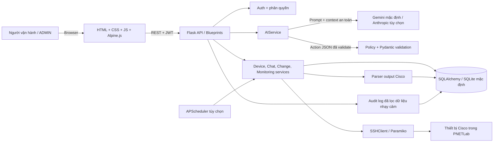
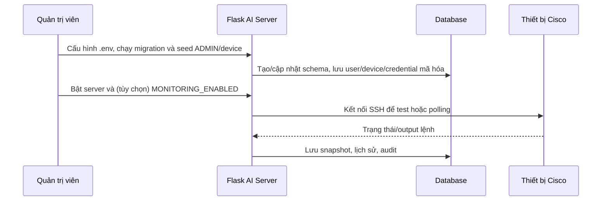
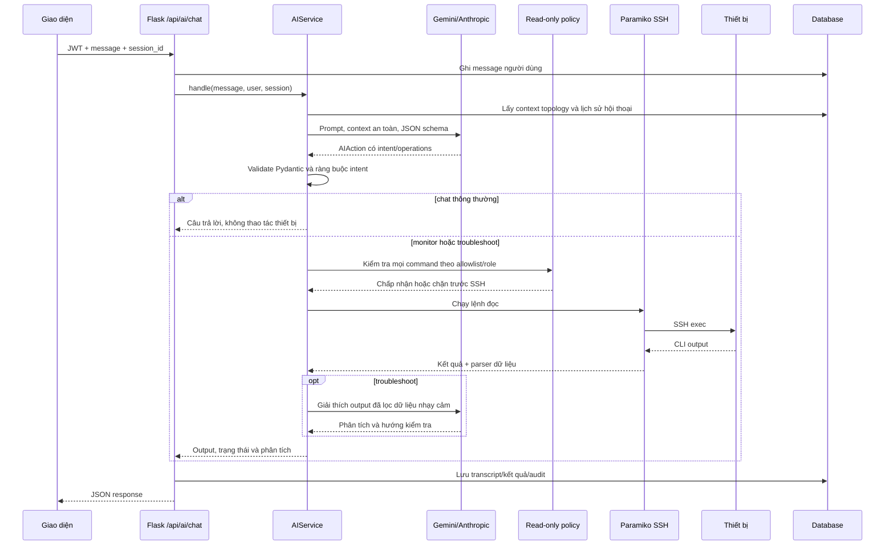

# Tổng quan project AI Network Copilot

> Tài liệu được tổng hợp từ mã nguồn hiện có trong `backend/src/network_copilot`, cấu hình đóng gói, migration, giao diện tĩnh và README. Các bản thiết kế trong `docs/superpowers` được dùng làm bối cảnh; chức năng chỉ được xem là hiện thực khi có mã nguồn tương ứng. Ngày rà soát: 07-10-2026.

## 1. Mục tiêu và phạm vi

Project xây dựng một AI server hỗ trợ vận hành mạng Cisco trong lab PNETLab. Người vận hành có thể hỏi trạng thái thiết bị, nhờ AI phân tích lỗi, hoặc mô tả yêu cầu cấu hình bằng tiếng Việt/Anh. Backend lấy dữ liệu qua SSH, kiểm soát lệnh, lưu lịch sử và kiểm toán; mọi thay đổi cấu hình phải đi qua quy trình **Preview → Approve → Apply → Verify**.

AI chỉ phân loại yêu cầu và đề xuất thao tác theo cấu trúc dữ liệu. Backend xác thực lại đề xuất, dựng bản xem trước theo từng thiết bị và không cho model tự mở SSH hay tự áp dụng cấu hình. Quyền duyệt/thực thi thuộc ADMIN.

Phạm vi hiện tại tập trung vào thiết bị Cisco trong topology PNETLab, gồm IOS và một số hỗ trợ đọc trạng thái Cisco ASA. Đây không phải nền tảng zero-touch provisioning hay hệ thống tự khám phá thiết bị. Rollback hiện được biểu diễn thành hướng dẫn/lệnh đề xuất; mã nguồn không tự chạy rollback.

## 2. Công nghệ sử dụng

| Lớp | Công nghệ | Vai trò |
|---|---|---|
| Ngôn ngữ/runtime | Python 3.11+ | Backend; project khai báo không hỗ trợ Python thấp hơn 3.11. |
| Web/API | Flask 3+ | Tạo ứng dụng, REST API, phục vụ trang HTML. |
| ORM và database | SQLAlchemy 2+, Flask-SQLAlchemy | Mô hình dữ liệu và truy vấn. SQLite là cấu hình mặc định; `DATABASE_URL` cho phép đổi URI database. |
| Migration | Flask-Migrate, Alembic | Quản lý thay đổi schema qua các migration trong `backend/migrations`. |
| Xác thực | Flask-JWT-Extended | Phát hành và xác minh JWT cho API. |
| Giới hạn request | Flask-Limiter | Rate limit, ví dụ đăng nhập 5 lần/phút/IP. |
| Kiểm tra dữ liệu | Pydantic 2+ | Parse/validate request, cấu trúc hành động AI và schema thiết bị. |
| Kết nối thiết bị | Paramiko 3.4 đến dưới 5 | SSH tới thiết bị Cisco; giới hạn phiên bản để giữ tương thích thuật toán SSH của image lab cũ. |
| Lập lịch | APScheduler 3+ | Poll trạng thái thiết bị nền, bật qua cấu hình. |
| Mã hóa bí mật | cryptography / Fernet | Mã hóa credential thiết bị lưu trong database. |
| AI mặc định | Google GenAI SDK (`google-genai`) | Provider Gemini; model lấy từ `AI_MODEL`, mặc định `gemini-2.5-flash`. |
| AI tùy chọn | Anthropic SDK (extra `anthropic`) | Provider Claude khi cài extra và cấu hình `AI_PROVIDER=anthropic`. |
| Cấu hình môi trường | python-dotenv, biến môi trường | Nạp API key, secret, database, timeout và cấu hình monitoring. |
| Giao diện | HTML, CSS, JavaScript, Alpine.js | Trang chat/copilot và dashboard; không có frontend framework build riêng. Alpine.js được vendored trong `static/vendor`. |
| Production server | Gunicorn (theo README/deploy setup) | Phục vụ Flask qua WSGI trên AI Server. |
| Test/dev | pytest, pytest-cov | Bộ test backend, fakes cho AI/SSH để test không cần kết nối thật. |

## 3. Sơ đồ khung kiến trúc



### Cấu trúc thư mục quan trọng

```text
backend/
  src/network_copilot/
    app.py, config.py, extensions.py, errors.py
    auth/          đăng nhập, user, JWT, role
    devices/       danh mục thiết bị và kiểm tra kết nối
    credentials/   mã hóa/lưu credential SSH
    ssh/           SSH client, xử lý prompt và lỗi Cisco
    commands/      allowlist lệnh chỉ đọc và lịch sử chạy lệnh
    parsers/       parser output IOS/ASA thành dữ liệu có cấu trúc
    monitoring/    polling, snapshot và scheduler
    dashboard/     tổng hợp tình trạng lab
    ai/            provider, schema, context topology, điều phối AI
    chat/          session và transcript hội thoại
    changes/       preview, batch, approval, apply, verify, rollback guidance
    backups/       lưu running-config trước khi áp dụng
    audit/         nhật ký thao tác
    evaluation/    chạy/scoring bộ prompt đánh giá AI
    static/, templates/ giao diện trình duyệt
  migrations/      lịch sử schema database
  scripts/         seed, triển khai, demo, smoke test và đánh giá
  tests/           unit, API và end-to-end tests
  evaluation/      corpus/schema tình huống đánh giá
docs/
  superpowers/     bản thiết kế và kế hoạch tính năng
  evidence/        bằng chứng đánh giá
```

## 4. Các module và chức năng

| Module | Trách nhiệm/chức năng chính |
|---|---|
| `app.py`, `config.py`, `extensions.py` | Application factory, cấu hình từ môi trường, khởi tạo database/JWT/migration/rate limiter, đăng ký blueprint, request ID, security headers và xử lý lỗi thống nhất. |
| `auth` | Đăng nhập, kiểm tra mật khẩu, cấp JWT, endpoint thông tin người dùng; decorator kiểm soát vai trò. Vai trò có quyền thao tác cao là `ADMIN`. |
| `devices` | CRUD thiết bị; kiểm tra hostname/IP thuộc management subnet, duy nhất; kiểm tra SSH reachability; truy xuất backup và snapshot. |
| `credentials` | Lưu credential theo thiết bị, mã hóa bằng Fernet với `CREDENTIAL_ENCRYPTION_KEY`; không đưa credential vào serialization/API. |
| `ssh` | Kết nối Paramiko, timeout, xác thực, chạy show/config/exec tương tác, xử lý prompt xác nhận và lỗi cú pháp/lệnh của Cisco. |
| `commands` | Thực thi lệnh đọc theo allowlist. Từ chối lệnh không nhận diện, lệnh nguy hiểm và ký tự nối lệnh; lưu lịch sử thực thi. Chính sách AI còn chặn đọc toàn bộ running-config. |
| `parsers` | Chuyển output CLI thành bản ghi có cấu trúc: interface, route IOS/ASA, OSPF neighbor, VLAN, switchport/trunk, DHCP pool, ACL và cấu hình interface. |
| `monitoring` | Poll lệnh trạng thái trên các thiết bị bật monitoring, cập nhật status/last_seen và lưu snapshot; có API refresh thủ công và lịch sử snapshot. Scheduler tắt mặc định, chu kỳ mặc định 60 giây khi bật. |
| `dashboard` | Tóm tắt thiết bị theo vai trò, tình trạng OSPF và sức khỏe topology cho giao diện dashboard. |
| `ai` | Tạo safe context (hostname/role/device type/status, lệnh hỗ trợ và topology), gửi prompt cho provider, nhận JSON theo schema, phân loại chat/monitor/configure/troubleshoot và điều phối tác vụ. |
| `chat` | Quản lý phiên hội thoại, tin nhắn user/assistant, tiêu đề và lịch sử; lịch sử gần đây được cấp lại cho AI theo session. |
| `changes` | Phân tích lệnh cấu hình, nhận diện capability/risk, đóng gói mode, sinh verification và rollback guidance; preview đơn/batch, approval, cancel, apply, backup, xác minh sau cấu hình. |
| `backups` | Chạy `show running-config` theo luồng nội bộ trước apply và lưu snapshot cấu hình làm bản sao lưu. |
| `audit` | Ghi sự kiện đăng nhập, AI, preview/approve/apply/cancel; lọc thông tin nhạy cảm trước khi ghi và cung cấp truy vấn log có phân quyền. |
| `evaluation` | Đọc prompt corpus, chạy dry-run với provider/fake provider, ghi trace và chấm mức khớp intent/command. |
| `static` + `templates` | UI trang chính/chat và dashboard; gọi API bằng `fetch`, giữ token phía client và hiển thị preview/batch/kết quả. |
| `scripts` | Seed user/lab, đặt credential, cài AI server, chạy demo/smoke test thật, thu thập evidence và đánh giá AI. |

## 5. Chức năng nghiệp vụ theo ý định AI

1. **Chat thông thường**: trả lời kiến thức mạng hoặc hội thoại; không resolve thiết bị, không mở SSH.
2. **Monitor**: AI chọn các lệnh đọc được hỗ trợ cho một hostname cụ thể; backend kiểm tra allowlist, chạy lệnh và trả output/parser result.
3. **Troubleshoot**: tương tự monitor, sau đó gửi output chẩn đoán đã lọc dữ liệu nhạy cảm cho provider để giải thích nguyên nhân khả dĩ và bước kiểm tra tiếp theo. Không tự sửa cấu hình.
4. **Configure**: AI tạo operation có hostname/mode/commands/verification. Backend bắt buộc ADMIN, kiểm tra lệnh và capability, đóng băng danh tính đích cùng lệnh thành batch preview. Người vận hành xem và duyệt; apply mới kết nối SSH.

Các operation có thể nhắm nhiều thiết bị và chia thành nhóm lệnh khác nhau; backend tạo change con cho từng hostname. Với batch có lệnh nguy hiểm, yêu cầu xác nhận chính xác theo hostname hoặc `CONFIRM ALL` trước bất kỳ kết nối SSH nào.

## 6. Quy trình hoạt động

### 6.1. Khởi động và chuẩn bị lab



README triển khai AI Server mô tả node Linux trong PNETLab, interface management dự kiến `172.16.3.28/24`, gateway `172.16.3.1`, và service Gunicorn trên cổng 5000. Đây là cấu hình triển khai được tài liệu hướng dẫn; địa chỉ IP không phải hằng số được ép trong logic ứng dụng. Phần network/netplan được cấu hình thủ công.

### 6.2. Luồng chat, giám sát và khắc phục sự cố



AI context không bao gồm mật khẩu, management IP hay toàn bộ running-config. Topology chỉ chứa các mạng vận hành được suy ra từ snapshot đã parse; mạng có chứa management IP bị loại. Lệnh đọc kiểm tra cả AI policy ở server, không dựa riêng vào prompt.

### 6.3. Luồng cấu hình an toàn

```mermaid
sequenceDiagram
    participant Op as ADMIN
    participant UI as Giao diện
    participant API as Flask API
    participant AI as AIService
    participant DB as Database
    participant SSH as Paramiko SSH
    participant Dev as Cisco devices
    Op->>UI: Mô tả cấu hình bằng ngôn ngữ tự nhiên
    UI->>API: POST /api/ai/chat với JWT
    API->>AI: Gọi provider và validate AIAction
    AI->>AI: Kiểm tra ADMIN, hostname, mode, operation
    AI->>DB: Tạo batch + change preview theo từng thiết bị
    AI-->>UI: Preview, risk, warnings, lệnh, verification, confirmation text
    Op->>UI: Kiểm tra và approve batch
    UI->>API: POST /api/change-batches/{id}/approve
    API->>DB: Đánh dấu batch và change con approved
    Op->>UI: Apply; nhập xác nhận nếu change nguy hiểm
    UI->>API: POST /api/change-batches/{id}/apply
    API->>API: Kiểm tra trạng thái/confirmation và claim batch nguyên tử
    loop Từng thiết bị theo thứ tự hostname
        API->>SSH: Backup show running-config
        SSH->>Dev: Lấy cấu hình hiện tại
        Dev-->>DB: Lưu bản backup
        API->>SSH: Chạy lệnh cấu hình/exec đã duyệt
        SSH->>Dev: SSH interactive command sequence
        Dev-->>API: Output
        API->>SSH: Chạy lệnh verification chỉ đọc
        SSH->>Dev: Kiểm tra trạng thái sau thay đổi
        Dev-->>API: Kết quả xác minh
        API->>DB: Lưu command execution, change state, audit
    end
    API-->>UI: success / failed / partial_success + kết quả từng thiết bị
```

Các trạng thái change/batch thường gặp gồm `pending_approval`, `approved`, `running`, `success`, `failed`, `partial_success`, `cancelled`. Với batch, các thiết bị được chạy tuần tự. Thành công một phần cần người vận hành xem từng kết quả trước khi retry.

Backend phân loại lệnh phá hoại thành preview mức rủi ro cao và buộc typed confirmation. Trước mỗi apply luôn backup `show running-config`; sau apply luôn chạy verification, lỗi verify không được báo thành công. Rollback commands được tạo để hướng dẫn thao tác thủ công, không tự động chạy.

### 6.4. Luồng monitoring nền

Khi `MONITORING_ENABLED=true`, APScheduler khởi chạy tác vụ polling định kỳ (60 giây mặc định). Monitoring lấy danh sách thiết bị bật theo dõi, chọn lệnh theo role/device type, mở SSH, parse output, cập nhật tình trạng và lưu `DeviceSnapshot`. API refresh cho phép yêu cầu poll một thiết bị; dashboard tổng hợp dữ liệu gần nhất. Status là dữ liệu snapshot gần nhất và có thể cũ.

## 7. Dữ liệu được lưu

Các model/migration chính cho thấy database quản lý:

- `users`: tài khoản và role; mật khẩu lưu dạng hash.
- `devices`: hostname, management IP, role, device type, trạng thái/monitoring.
- `device_credentials`: credential SSH đã mã hóa.
- `device_snapshots`: trạng thái và dữ liệu quan sát được theo lần poll.
- `chat_sessions`, `chat_messages`: phiên và transcript; payload có thể giữ thông tin kết quả lệnh để UI hiển thị.
- `command_executions`: lệnh, trạng thái, output/thời lượng/nguồn.
- `config_backups`: running-config trước khi thay đổi.
- `change_batches`, `change_requests`: preview, target đã đóng băng, lệnh, risk, phê duyệt, kết quả apply/verify.
- `audit_logs`: hành động quản trị và kết quả đã được redact.

## 8. API chính

Hầu hết API nghiệp vụ yêu cầu JWT. Các route tiêu biểu:

| Nhóm | Endpoint | Mục đích |
|---|---|---|
| Health/UI | `GET /api/health`, `GET /`, `GET /dashboard` | Liveness và trang giao diện. |
| Auth | `POST /api/auth/login`, `GET /api/auth/me` | Đăng nhập lấy JWT, xem user hiện tại. |
| Thiết bị | `/api/devices` và `/<id>` | Liệt kê/thêm/xem/sửa/xóa thiết bị; ADMIN quản lý. Có `/<id>/test-connection`, `/<id>/backups`. |
| Commands | `POST /api/commands/execute-readonly`, `GET /api/commands/history` | Chạy lệnh đọc an toàn và tra lịch sử. |
| Monitoring | `GET /api/devices/<id>/status`, `GET .../snapshots`, `POST .../refresh` | Xem trạng thái, snapshot và poll tức thì. |
| AI | `POST /api/ai/chat` | Chat, monitor, troubleshoot hoặc sinh preview cấu hình. |
| Chat | `GET/POST /api/chat/sessions`, `GET /api/chat/messages` | Tạo/liệt kê session và tải transcript. |
| Changes | `POST /api/changes/preview`, `GET /api/changes`, `POST /api/changes/<id>/{approve,apply,cancel}` | Quy trình change đơn lẻ. |
| Batch | `/api/change-batches` và `/<id>/{approve,apply,cancel}` | Duyệt/thực thi thay đổi nhiều thiết bị. |
| Dashboard | `GET /api/dashboard/summary` | Tóm tắt sức khỏe lab. |
| Audit | `GET /api/audit-logs` | Tra cứu audit; yêu cầu quyền cao theo route. |

## 9. Bảo mật và giới hạn vận hành

- API giới hạn đăng nhập và gắn `X-Request-ID`; response có các header bảo vệ như `nosniff`, `DENY`, `no-store`.
- Mật khẩu user được hash; credential thiết bị được Fernet encrypt. Mất `CREDENTIAL_ENCRYPTION_KEY` làm credential đã lưu không thể giải mã.
- Read-only command dùng allowlist; lệnh lạ và command chaining bị từ chối trước khi mở SSH.
- AI không được đọc cấu hình đầy đủ hay credential; nội dung troubleshoot được redact trước khi gửi phân tích cho model.
- Cấu hình chỉ được thực hiện qua đối tượng preview đã lưu, duyệt bởi ADMIN; target identity được đóng băng để giảm nguy cơ đổi thiết bị sau approval.
- Có backup trước khi áp dụng, xác minh sau khi áp dụng, và ghi audit. Các kiểm soát này được nêu trong README và hiện diện trong service tương ứng.
- Tài liệu README cho biết test suite dùng fake SSH/provider để không gọi mạng hoặc model thật. Cần cấu hình riêng AI key và mạng lab để demo tích hợp thật.
- Không có bằng chứng về đa vendor đầy đủ, auto-discovery, tự rollback, HA/cluster, hoặc frontend SPA độc lập; không nên mô tả các năng lực này là đã hoàn thành.

## 10. Cấu hình và triển khai

Các biến quan trọng: `SECRET_KEY`, `JWT_SECRET_KEY`, `DATABASE_URL`, `CREDENTIAL_ENCRYPTION_KEY`, `MANAGEMENT_NETWORK`, `SSH_CONNECT_TIMEOUT`, `SSH_COMMAND_TIMEOUT`, `MONITORING_ENABLED`, `MONITORING_INTERVAL_SECONDS`, `AI_PROVIDER`, `AI_MODEL`, `AI_API_KEY`, `RATELIMIT_ENABLED`, `RATELIMIT_STORAGE_URI`.

Luồng triển khai được README/scripts mô tả: cài Python 3.11+, tạo virtualenv và cài package, tạo `.env` cùng khóa Fernet/secret, chạy `flask db upgrade`, seed ADMIN/lab, cấu hình credential thiết bị, kiểm tra đường mạng/SSH, rồi khởi động Flask hoặc Gunicorn service. Script `setup_ai_server.sh` thực hiện phần chuẩn bị phần mềm trên node Linux và dừng trước khi tự đặt mật khẩu ADMIN.

## 11. Kiểm thử và đánh giá

`backend/tests` có test cho auth, security, device, SSH, parser, command policy, AI provider/schema/context, chat, monitoring, changes/batch/rollback/verification, dashboard và flow lab. Có fake SSH client và fake AI provider. `backend/evaluation/prompt_corpus.json` cùng runner/scoring hỗ trợ đánh giá prompt; `evaluation/pnetlab_scenario.*` mô tả scenario dữ liệu cho lab.

## 12. Tóm tắt luồng tổng thể

```text
Người dùng đăng nhập
  → UI gửi yêu cầu kèm JWT
  → Flask xác thực quyền và ghi nhận request
  → AI (nếu dùng) nhận context topology đã giới hạn, trả action JSON
  → Backend xác thực schema + policy
      ├─ chat: trả lời, không truy cập thiết bị
      ├─ monitor/troubleshoot: allowlist → SSH đọc → parse → trả kết quả
      └─ configure: ADMIN → preview/batch → approval → confirmation nếu cần
           → backup → apply tuần tự → verification → lưu trạng thái/audit
  → UI hiển thị câu trả lời, preview hoặc kết quả
```

Kiến trúc đặt quyền kiểm soát cuối cùng ở backend: AI diễn giải yêu cầu, còn policy engine, role, change workflow, SSH service và verification quyết định điều gì thực sự được phép chạy trên thiết bị.
