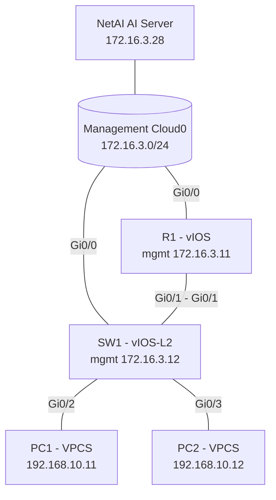

# Kịch bản video demo: Đưa lab từ PNETLab sang NetAI

**Thời lượng dự kiến:** 5–6 phút · **Định dạng:** quay màn hình 1920×1080 + thuyết minh tiếng Việt

**Thông điệp chính:** Lab đã dựng sẵn trên PNETLab → NetAI đọc lab qua API → tự tạo thiết bị và sơ đồ → khởi tạo SSH qua console → từ đó giám sát và cấu hình bằng AI, có duyệt trước khi áp dụng.

---

## 1. Sơ đồ lab dùng trong video

Một router, một switch và hai PC. Cổng Gi0/0 của R1 và SW1 nối vào **Management(Cloud0)** để AI Server SSH tới được.

```
                  Management(Cloud0) — 172.16.3.0/24
                  AI Server (NetAI) 172.16.3.28, gateway 172.16.3.1
                     |                         |
                Gi0/0 (172.16.3.11)       Gi0/0 (172.16.3.12)
               +------------+  Gi0/1   Gi0/1 +-------------+
               |  R1 (vIOS) |------------------| SW1 (vIOS-L2)|
               +------------+                  +-------------+
          LAN 192.168.10.1/24              Gi0/2 |        | Gi0/3
                                           +-----+--+  +--+-----+
                                           |  PC1   |  |  PC2   |
                                           | (VPCS) |  | (VPCS) |
                                           +--------+  +--------+
                                          192.168.10.11  192.168.10.12
```



| Node | Template PNETLab | NetAI nhận thành | IP quản trị |
|---|---|---|---|
| R1 | vIOS | `cisco_ios` / core | 172.16.3.11 |
| SW1 | vIOS-L2 | `cisco_ios` / access | 172.16.3.12 |
| PC1, PC2 | VPCS | `generic` / host (không có SSH) | — |

> Dây nối vào Cloud0 **không** được nhập thành dây trên sơ đồ, vì NetAI coi Cloud là mạng quản trị chứ không phải cáp giữa hai thiết bị. Sau khi nhập sẽ có đúng **3 dây nối**: R1–SW1, SW1–PC1, SW1–PC2.

---

## 2. Chuẩn bị trước khi quay (không quay)

1. **PNETLab:** dựng lab `DemoNetAI` theo sơ đồ trên, **bật sẵn tất cả node** và đợi vIOS boot xong (khoảng 3–5 phút). Mở sẵn lab trên một tab.
   - Muốn video có cảnh khởi tạo SSH (cảnh 5) thì để R1/SW1 **ở cấu hình trắng**.
   - Muốn video ngắn và an toàn hơn thì cấu hình sẵn IP quản trị và SSH, rồi bỏ cảnh 5.
2. **NetAI:** đăng nhập bằng ADMIN, tạo project `Demo PNETLab` với dải quản trị `172.16.3.0/24`.
   - Tab **Thiết bị** → **SSH mặc định của project** → **Thiết lập** (ví dụ `g1` / mật khẩu lab) → **Lưu**.
   - Tab **Cài đặt** → bật **AI Management cho project PNETLab này** (cần cho cảnh 7).
3. **Lưu ý về phiên PNETLab:** PNETLab chỉ cho một phiên đăng nhập trên mỗi tài khoản. Khi NetAI đăng nhập, tab PNETLab của cùng tài khoản sẽ bị đăng xuất. Nên dùng tài khoản riêng cho NetAI, hoặc chuẩn bị đăng nhập lại PNETLab ở cảnh 8.
4. Chạy thử toàn bộ một lần, sau đó **xoá thiết bị vừa nhập** khỏi project để quay lại từ đầu.
5. Ẩn bookmark và thông báo, phóng to trình duyệt lên 110–125% cho chữ dễ đọc.

---

## 3. Kịch bản từng cảnh

### Cảnh 1 — Mở đầu (0:00–0:20)
- **Màn hình:** slide tiêu đề "NetAI — AI Network Copilot cho PNETLab", tên nhóm.
- **Thuyết minh:** "Xin chào, nhóm 1 xin giới thiệu NetAI, trợ lý AI giúp vận hành mạng Cisco trong PNETLab. Trong video này, chúng tôi sẽ đưa một lab có sẵn trên PNETLab sang NetAI, sau đó giám sát và cấu hình thiết bị bằng tiếng Việt."

### Cảnh 2 — Lab trên PNETLab (0:20–0:50)
- **Màn hình:** tab PNETLab, lab `DemoNetAI`. Rê chuột lần lượt qua R1, SW1, PC1, PC2 và Cloud0.
- **Thao tác:** mở console R1, gõ `show ip interface brief` để thấy thiết bị đang chạy (nếu để cấu hình trắng thì sẽ thấy chưa có IP).
- **Thuyết minh:** "Đây là lab trên PNETLab gồm một router vIOS, một switch vIOS-L2 và hai PC. Cổng Gi0/0 của router và switch nối vào mạng Management để AI Server kết nối tới. Hiện tại lab chỉ tồn tại trên PNETLab, chưa hệ thống nào quản lý nó."

### Cảnh 3 — Mở chức năng nhập (0:50–1:30)
- **Màn hình:** NetAI → **Projects** → project `Demo PNETLab` → tab **Thiết bị** (đang trống).
- **Thao tác:** bấm **Nhập từ PNETLab** rồi điền:
  - URL PNETLab: địa chỉ máy PNETLab
  - Tài khoản / Mật khẩu
  - Đường dẫn lab: để trống (dùng lab đang mở trong phiên)
  - Kiểu API: **Tự động**
  - Tick **Ghi nhớ đăng nhập PNETLab cho project này**
- Bấm **Tải danh sách node**.
- **Thuyết minh:** "Trong NetAI, chúng tôi mở project và chọn Nhập từ PNETLab. NetAI chỉ đọc danh sách node, mạng và dây nối qua API của PNETLab, không bật, tắt hay sửa node nào. Mật khẩu được mã hoá nếu chọn ghi nhớ."

### Cảnh 4 — Xem trước và nhập (1:30–2:20)
- **Màn hình:** bảng node vừa tải về. **Phóng to (zoom) vào bảng** khi dựng video.
- **Chỉ ra:**
  - R1 → `cisco_ios / core`, SW1 → `cisco_ios / access`, PC → `generic / host`.
  - Dòng "Đọc qua: API phiên PNETLab" và "Phát hiện 3 dây nối giữa hai node".
- **Thao tác:** sửa cột **IP quản trị** thành `172.16.3.11` (R1) và `172.16.3.12` (SW1). Để trống ô SSH (dùng SSH mặc định). Bấm **Nhập 4 thiết bị**.
- **Kết quả:** mỗi thiết bị hiện `created`, kèm dòng "Dây nối đã tạo: 3".
- **Thuyết minh:** "NetAI tự nhận loại thiết bị dựa trên template: vIOS là router, vIOS-L2 là switch, VPCS là máy trạm. PNETLab không biết IP quản trị nên chúng tôi nhập IP thật cho từng thiết bị. Bấm Nhập, toàn bộ thiết bị và ba dây nối được tạo trong project."

### Cảnh 5 — Khởi tạo SSH qua console (2:20–3:20) *(bỏ nếu thiết bị đã có SSH)*
- **Màn hình:** khung **Khởi tạo SSH qua console** ngay bên dưới.
- **Thao tác:**
  - Nhập Gateway `172.16.3.1` → **Xem lệnh khởi tạo**.
  - Trên dòng R1, bấm **Xem lệnh** để khán giả thấy các lệnh sẽ chạy (IP trên Gi0/0, user, `crypto key`, `ip ssh version 2`…).
  - Bấm **Khởi tạo 2 thiết bị**, xác nhận, rồi mở **Nhật ký từng bước**.
- **Dựng video:** tua nhanh 4–8 lần đoạn chờ job, chỉ giữ lại lúc bắt đầu và lúc kết thúc.
- **Kết quả:** R1 và SW1 hiện `ok`, kèm "SSH từ nay dùng tài khoản g1".
- **Thuyết minh:** "Thiết bị mới trên PNETLab chưa có IP và SSH. NetAI mở console telnet của từng node qua máy PNETLab, đặt IP quản trị, tạo tài khoản, bật SSH rồi kiểm tra lại bằng SSH. Toàn bộ lệnh được hiện ra để xem trước khi chạy."

### Cảnh 6 — Sơ đồ mạng và Dashboard (3:20–4:00)
- **Màn hình:** tab **Sơ đồ mạng**. Bốn thiết bị nằm đúng vị trí như trên PNETLab, có ba dây nối và tên cổng. Đặt **cạnh nhau** (split screen) với ảnh lab PNETLab khi dựng.
- **Thao tác:** chuyển sang **Dashboard** để thấy R1 và SW1 đang trực tuyến.
- **Thuyết minh:** "Sơ đồ trong NetAI giữ nguyên vị trí và dây nối của lab PNETLab. Dashboard cho thấy trạng thái các thiết bị mà AI Server đã kết nối được qua SSH."

### Cảnh 7 — Giám sát và cấu hình bằng AI (4:00–5:20)
- **Màn hình:** trang **Chat**.
- **Câu 1 (giám sát):** `Kiểm tra trạng thái các interface trên R1`
  → AI chạy lệnh đọc `show ip interface brief` và hiện bảng kết quả.
- **Câu 2 (cấu hình):** `Đặt IP 192.168.10.1/24 cho cổng Gi0/1 của R1 và bật cổng lên`
  → AI hiện khung **Cấu hình gợi ý theo thiết bị**: mở **Xem tệp cấu hình** để thấy các lệnh.
  → bấm **Duyệt và áp dụng trên PNETLab**. Nếu thanh bên phải hiện batch đang chờ duyệt thì bấm duyệt rồi áp dụng ở đó.
  → kết quả `success` cùng output xác minh.
  *(Nút này chỉ hiện khi project đã bật AI Management, xem phần chuẩn bị.)*
  *Chạy thử trước để biết chính xác các bước bấm trên phiên bản đang dùng.*
- **Thuyết minh:** "Bây giờ có thể hỏi bằng tiếng Việt. Với yêu cầu giám sát, AI chỉ được chạy lệnh đọc nằm trong danh sách cho phép. Với yêu cầu cấu hình, AI không tự áp dụng: hệ thống tạo bản xem trước, ADMIN duyệt, rồi NetAI sao lưu running-config, áp dụng và xác minh lại."

### Cảnh 8 — Kiểm chứng trên PNETLab và kết thúc (5:20–5:50)
- **Màn hình:** quay lại PNETLab (đăng nhập lại nếu bị đăng xuất), mở console R1, gõ `show ip interface brief`: Gi0/1 đã có `192.168.10.1` và trạng thái `up`. Từ PC1 chạy `ping 192.168.10.1` nếu PC đã có IP.
- **Slide kết:** tóm tắt luồng `PNETLab → Nhập → Khởi tạo SSH → Giám sát / Cấu hình có duyệt`.
- **Thuyết minh:** "Trên PNETLab, cấu hình đã được áp dụng đúng. Như vậy NetAI đã nhận một lab có sẵn từ PNETLab và vận hành nó an toàn bằng AI. Cảm ơn thầy và các bạn đã theo dõi."

---

## 4. Ghi chú khi dựng video
- Cắt bỏ các đoạn chờ tải, chỉ để lại 1–2 giây trước khi kết quả hiện ra.
- Zoom vào: bảng node (cảnh 4), lệnh khởi tạo (cảnh 5), preview cấu hình (cảnh 7).
- Thêm chú thích chữ trên màn hình ở mỗi cảnh: "Bước 1: Nhập lab", "Bước 2: Khởi tạo SSH"…
- Không để lộ mật khẩu: điền form trước khi bắt đầu quay đoạn đó, hoặc làm mờ khi dựng.
